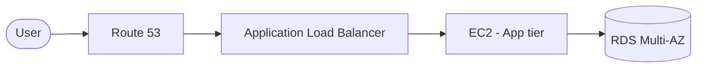

<p align="center">
  
</p>

<p align="center">
  
</p>

<p align="center">
  
  
  
  
  
</p>

---

## 🖥️ whoami

```bash
$ whoami
shruti_chetan_dalvi

$ cat about.txt
role        : React Developer & Aspiring Cloud/DevOps Engineer ☁️
studying    : MCA | B.Sc. Computer Science (9.51 CGPA)
building    : Cloud-native apps on AWS
learning    : Docker 🐳 | Kubernetes ☸️ | Terraform 🌍
loves       : CI/CD, Linux & infrastructure automation
achievement : 🏆 National Winner, Smart India Hackathon 2025
status      : Always shipping, always learning 🌱

$ contact --email
📫 shrutidalvi229@gmail.com
```

---

## 🧰 Tech stack

**Frontend & Backend**


**Cloud & DevOps**


**Design**


---

## 🚀 Featured projects

| Project | What it is | Built with |
|---|---|---|
| **StreamVault** | Netflix-style streaming app on a 3-tier AWS architecture, with a deployment guide | AWS, Route 53, ALB, EC2, RDS |
| **Aurora Streams** | Second version of the same streaming app, structured around the same 3-tier pattern | AWS, Route 53, ALB, EC2, RDS |

[View StreamVault](https://github.com/shrutidalvi09/REPO-NAME) · [View Aurora Streams](https://github.com/shrutidalvi09/REPO-NAME)



---

## 🌱 Currently learning

| Topic | Goal |
|---|---|
| 🐳 Docker | Containerise my apps |
| ☸️ Kubernetes | Deploy and scale containers |
| 🌍 Terraform | Provision AWS with code |

---

## 🏆 Highlights

- 🥇 **National Winner**, Smart India Hackathon 2025
- 🎓 **9.51 CGPA** in B.Sc. Computer Science, now pursuing MCA
- 💼 **Intern**, GBM Softech: Spring Boot and MySQL
- 🎨 **Intern**, Ada Lovelace Technologies: UI/UX and Figma

---

## 📫 Let's connect

<p align="center">
  <a href="mailto:shrutidalvi229@gmail.com"></a>
  <a href="https://github.com/shrutidalvi09"></a>
</p>

---

<p align="center">
  <b><i>🌟 Keep Learning • Keep Building • Keep Growing 🌟</i></b>
</p>
