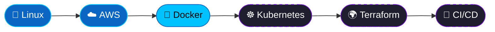

<p align="center">
  
</p>

<p align="center">
  
</p>

<p align="center">
  
  
  
  
</p>

<p align="center">
  <a href="mailto:shrutidalvi229@gmail.com"></a>
</p>


## 🖥️ Boot Sequence

<table>
<tr>
<td width="55%" valign="top">

```bash
$ whoami
shruti_chetan_dalvi

$ cat about.txt
role      : Cloud & DevOps Aspirant ☁️
building  : Cloud-native apps on AWS
learning  : Docker • Kubernetes • Terraform
loves     : CI/CD • Linux • Automation
won       : 🏆 Smart India Hackathon 2025
mindset   : Ship it. Break it. Fix it. 🔁

$ echo $STATUS
Always learning, always building 🌱
```

</td>
<td width="45%" valign="top">

### 🎯 Current Focus

- 🐳 Containerising apps with **Docker**
- ☸️ Orchestrating with **Kubernetes**
- 🌍 Infrastructure as Code with **Terraform**
- 🔁 Automating with **CI/CD pipelines**

### 🌱 Next Up

- ⚙️ AWS DevOps tooling
- 📂 More hands-on cloud projects

</td>
</tr>
</table>

## 🧰 My Toolbox

<table align="center">
<tr>
<td align="center"><b>☁️ Cloud & DevOps</b></td>
<td>
  
</td>
</tr>
<tr>
<td align="center"><b>🐧 Systems</b></td>
<td>
  
</td>
</tr>
<tr>
<td align="center"><b>💻 Code</b></td>
<td>
  
</td>
</tr>
<tr>
<td align="center"><b>🗄️ Data & Tools</b></td>
<td>
  
</td>
</tr>
</table>

## 🗺️ My Cloud Journey



<p align="center"><sub>✅ Done &nbsp;•&nbsp; 🔄 In progress (Docker) &nbsp;•&nbsp; ⬜ Coming up (dashed)</sub></p>

## 💬 Let's Build Something

<p align="center">
  Open to <b>Cloud</b>, <b>DevOps</b> & <b>Software Engineering</b> opportunities.<br/>
  If you're working on something cloud-native, let's talk. 📫 <b>shrutidalvi229@gmail.com</b>
</p>

<p align="center">
  <b><i>🌟 Keep Learning • Keep Building • Keep Growing 🌟</i></b>
</p>


