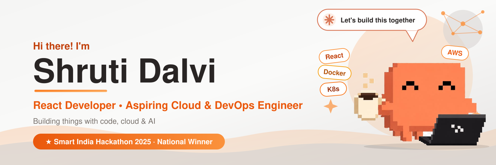

<p align="center">
  
</p>

<p align="center">
  
</p>
---

## 🖥️ whoami

```bash
$ whoami
shruti_chetan_dalvi

$ cat about.txt
role        : React Developer & Aspiring Cloud/DevOps Engineer ☁️
studying    : MCA | B.Sc. Computer Science (9.51 CGPA)
building    : Cloud-native apps on AWS
learning    : Docker 🐳 | Kubernetes ☸️ | Terraform 🌍
loves       : CI/CD, Linux & infrastructure automation
achievement : 🏆 National Winner, Smart India Hackathon 2025
status      : Always shipping, always learning 🌱

$ contact --email
📫 shrutidalvi229@gmail.com
```

---

## 🧰 Tech stack

**Frontend & Backend**


---

## 🏆 Highlights

- 🥇 **National Winner**, Smart India Hackathon 2025
- 🎓 **9.51 CGPA** in B.Sc. Computer Science, now pursuing MCA

---

<p align="center">
  <b><i>🌟 Keep Learning • Keep Building • Keep Growing 🌟</i></b>
</p>
